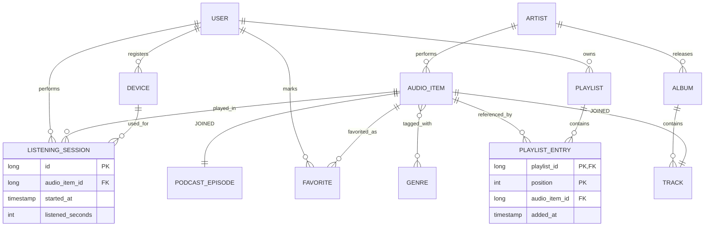

# SoundVault

Self-hosted music library and playlist manager. Tracks, podcast episodes, playlists and
listening habits - metadata only, no streaming, no audio files.

DBI course project at HTL Leonding, assignment **JPA.05 - JPA Project**.
Milestone `Production day`, due 2026-12-30.

> **Status: early implementation.** Entity skeleton with IDs, one mapping test, and an
> Angular client running on local demo data. No REST API, repositories, services,
> relations or seed data yet. Two mapping tests currently fail - see [P2](#p2) and [P3](#p3).
> Full picture: [Requirement coverage](#requirement-coverage).

## Team

| Name | GitHub |
| --- | --- |
| Victor Ehrenmueller-Jensen | [@VAZVictor](https://github.com/VAZVictor) |
| Elena Mayer | [@EleMayer](https://github.com/EleMayer) |
| Annika Neuhauser | [@A-Neuhauser](https://github.com/A-Neuhauser) |
| Paul Stolz | [@paulstolzz](https://github.com/paulstolzz) |

## Stack

| Layer | Technology |
| --- | --- |
| Backend | Quarkus 3.40.1, Java 25, Maven Wrapper (Maven 3.9.16) |
| Persistence | `quarkus-hibernate-orm`, Jakarta Persistence |
| REST / DTO | `quarkus-rest`, `quarkus-rest-jackson` |
| Validation / Docs / CDI | `quarkus-hibernate-validator`, `quarkus-smallrye-openapi`, `quarkus-arc` |
| Database | PostgreSQL 16 via `quarkus-jdbc-postgresql` |
| Backend tests | `quarkus-junit`, REST Assured, Mockito (`skipITs=true`) |
| Frontend | Angular 22.3 (standalone, signals), TypeScript 6.0, npm 11.9 |
| Frontend tests | Vitest 5 + jsdom via `@angular/build:unit-test` |

Built on Quarkus, not the originally planned Spring Boot stack - see [P4](#p4).

## Data model

Eleven classes carry `@Entity`; **all of them currently contain only an `id` field**.
Attributes and relations are still to be mapped.

| Entity | Purpose | Key |
| --- | --- | --- |
| `User` | listener, owns playlists, devices, favorites | `Long` IDENTITY |
| `Artist` | performer or podcast host | `Long` IDENTITY |
| `Album` | release grouping tracks | `Long` IDENTITY |
| `AudioItem` | abstract root of everything playable | `Long` IDENTITY |
| `Track` | music piece, subclass of `AudioItem` | inherited |
| `PodcastEpisode` | podcast episode, subclass of `AudioItem` | inherited |
| `Playlist` | master of an ordered list | `Long` IDENTITY |
| `PlaylistEntry` | detail row: position + addedAt | composite |
| `ListeningSession` | playback event with time range and device | `Long` IDENTITY |
| `Favorite` | user likes an audio item | `Long` IDENTITY |
| `Device` | playback device of a user | `Long` IDENTITY |
| `Genre` | currently an empty enum, not an entity - see [P5](#p5) | - |

### Target ER model

Describes the model agreed in issue #3, not the current code. Only the inheritance is
mapped so far.



### The three required special mappings

- **Master/detail - `Playlist` -> `PlaylistEntry`.** A dedicated entity, not a plain
  `@ManyToMany`, because order, `addedAt` and duplicates of the same track must be
  representable. Planned: `@OneToMany(mappedBy = "playlist", cascade = ALL,
  orphanRemoval = true)` plus `@OrderBy("position")`.
- **Composite key - `PlaylistEntryId(playlistId, position)`.** The value class is complete
  (`Serializable`, no-arg constructor, `equals`/`hashCode` via `Objects`); the JPA
  annotations are missing ([P3](#p3)). Because `position` is part of the identity,
  reordering is a delete plus insert, not an update - a trade-off we keep deliberately
  and show in the demo.
- **Inheritance - `AudioItem` -> `Track` / `PodcastEpisode`, `JOINED`.** Shared attributes
  in `audio_item`, subtype attributes in their own tables with PK = FK. Chosen over
  `SINGLE_TABLE` to avoid nullable columns and keep NOT NULL constraints; the cost is
  joins on polymorphic queries. Annotation is currently on the wrong class ([P2](#p2)).

**Delete rules (agreed, not implemented):** cascade + orphan removal from `Playlist` to
its entries and from `User` to playlists/devices/favorites. No cascade from `AudioItem`
to sessions, entries or favorites - deleting an item must not silently erase history;
the service rejects with a conflict instead. `Artist`/`Album` restrict while referenced.

**Other decisions:** associations `LAZY` with targeted `JOIN FETCH`; transaction boundary
in the service, never in the resource; a mix of typed JPQL/Criteria and named queries,
with DTO projections for aggregates. Concrete query strategy is fixed in issue #10.

## Architecture

```text
Angular client --HTTP/JSON--> at.htl.api      resources, exception mappers, OpenAPI
                              at.htl.model    request/response records (DTOs)
                                    |
                              at.htl.workloads  services = use cases, @Transactional
                                    |
                              at.htl.workloads  repositories, EntityManager encapsulated
                                    |
                              Hibernate ORM -> PostgreSQL, schema soundvault
```

`api`, `error`, `model` and `util` currently hold only `package-info.java`; `workloads`
holds the entities, one sub-package per domain area.

Rules: no `EntityManager` or repository calls in resources. Entities never leave the
service layer - the API speaks DTOs only. Domain errors live in `at.htl.error` and map
to 404 / 409 / 400 at the boundary. At least one use case must modify an already loaded,
managed entity and rely on dirty checking.

## Getting started

Requires **JDK 25**, Docker (or a local PostgreSQL 16), and Node.js matching Angular 22.

```bash
# 1. database - no docker-compose.yml yet (issue #2)
docker run --name soundvault-db -e POSTGRES_USER=postgres -e POSTGRES_PASSWORD=postgres \
  -e POSTGRES_DB=postgres -p 5432:5432 -v soundvault-data:/var/lib/postgresql/data -d postgres:16

# 2. backend - schema soundvault is created automatically
./mvnw quarkus:dev            # Windows: mvnw.cmd quarkus:dev
                              # Dev UI: http://localhost:8080/q/dev/

# 3. frontend
cd frontend && npm ci && npm start   # http://localhost:4200/
```

On `main` the client still renders the Angular starter page. The SoundVault UI lives on
branch `13-frontend-client` (4 commits ahead): `git checkout 13-frontend-client`.

Once resources exist (issue #14): `curl http://localhost:8080/q/openapi?format=yaml -o openapi.yaml`

## Configuration

`src/main/resources/application.properties` - the settings that matter:

| Property | Value | Note |
| --- | --- | --- |
| `...database.default-schema` | `soundvault` | own schema instead of `public` |
| `...schema-management.strategy` | `drop-and-create` | **wipes all data on every start** |
| `...schema-management.create-schemas` | `true` | creates `soundvault` |
| `...physical-naming-strategy` | `CamelCaseToUnderscoresNamingStrategy` | `ListeningSession` -> `listening_session` |
| `quarkus.hibernate-orm.log.sql` | `true` | SQL in the log, useful for the demo |
| `quarkus.http.cors.origins` | `*` | dev only, lets port 4200 call the API |

Connection defaults to `jdbc:postgresql://localhost:5432/postgres`, user/password
`postgres`. Override via env, e.g. `QUARKUS_DATASOURCE_JDBC_URL`. Profiles `dev` and
`test` are required by issue #1 but not created yet.

Frontend: `frontend/src/app/core/api.config.ts` exports
`API_BASE_URL = 'http://localhost:8080/api'` - defined, not used by any component yet.

## Tests

```bash
./mvnw test          # backend
cd frontend && npm test
```

`at.htl.workloads.EntityMappingTest` verifies the mapping by reflection, no database and
no `@QuarkusTest`. Four checks:

- all eleven classes are entities, `Genre` is not - **passes**
- eight classes use `Long id` with `@GeneratedValue(IDENTITY)`; `Track` and
  `PodcastEpisode` declare no own id and inherit `getId()` - **passes**
- `@Inheritance(JOINED)` sits on `AudioItem` - **fails**, see [P2](#p2)
- `PlaylistEntry` uses `@EmbeddedId`/`@IdClass` with an embeddable, serializable key
  of `Long playlistId` + `Integer position` - **fails**, see [P3](#p3)

No service, repository or REST tests exist. Testcontainers is required by issue #11 but
not yet a dependency; REST Assured and Mockito are present and unused.

Frontend: two starter smoke tests on `main`, six tests on `13-frontend-client`
(heading, component composition, navigation, search filtering, and totals staying
unchanged while filtering).

## Client

Angular 22, standalone components, signals instead of RxJS state, `input()`/`output()`,
new control flow (`@if`, `@for`, `@switch`, `@empty`). No routing yet - `app.routes.ts`
is empty and navigation runs through an `activeView` signal.

On `13-frontend-client`: `App` (shell, view state, demo data, computed filters),
`Sidebar`, `PageHeading` (search), `OverviewPage` (welcome card, three stat cards,
recent tracks, playlist selection), `TrackList`, `PlaylistCollection` (list or card grid).

Data is five hardcoded tracks and three playlists, filtered client-side. **No HTTP calls
happen** - `provideHttpClient()` is registered but unused. The interfaces in
`models/music.models.ts` are UI models, not backend DTOs.

## Planned use cases and queries

Not implemented. Binding specification in issues #10, #13, #14.

The three mandatory complex queries:

1. **Unused audio items per time range** - LEFT OUTER JOIN of `AudioItem` against
   `ListeningSession` and `PlaylistEntry`, filtered on `session.id IS NULL`. Must also
   return items never played and never playlisted; the seed needs such a track.
2. **Most popular artists** - `GROUP BY artist`, `SUM(listenedSeconds)`,
   `HAVING SUM(...) > :threshold`, descending, paged. Edge cases: empty result, artist
   exactly on the HAVING boundary.
3. **Playlist / library overview** - DTO projection with computed fields (entry count,
   total duration, last used) as a query object or constructor expression, not an entity graph.

| Use case | Flow |
| --- | --- |
| "What have I never listened to?" | pick a range, browse unused items with artist and duration |
| "Build a playlist" | name, select items, set order - one commit creates master and all details |
| "Reorder a playlist" | load, move positions, remove an entry - update on managed entities |
| "Top artists" | set threshold and page, ranked by aggregated listening time |

Further: record a listening session (user, device, item, duration) and toggle a favorite.

Draft endpoints:

```text
GET    /api/audio-items/unused?from=&to=
GET    /api/artists/top?minSeconds=&page=&size=
GET    /api/playlists/{id}/overview
POST   /api/playlists                creates playlist plus entries in one use case
PUT    /api/playlists/{id}/order     the update use case
DELETE /api/playlists/{id}
POST   /api/listening-sessions
PUT    /api/tracks/{id}
```

Insert/update/delete is deliberately not offered for every entity - dependent entities
are created through their aggregate use case, as the assignment allows.

## Requirement coverage

Single source of truth for progress. Backlog: 14 open, 2 closed.

| Requirement | State | Where / issue |
| --- | --- | --- |
| Group of 3-4, own topic | done | four contributors, music library |
| At least 10 entities | partial | 11 `@Entity` classes, id-only; `Genre` undecided - #3, #5, #6 |
| Master/detail relation | open | modelled, `@OneToMany` missing - #6 |
| Composite key | partial | key class complete, annotations missing - #8, [P3](#p3) |
| Inheritance relation | broken | hierarchy correct, annotation misplaced, test red - #8, [P2](#p2) |
| Three complex queries | open | specified only - #10 |
| Update use case on managed entity | open | #9 |
| REST API for insert/update/delete | open | extension present, no resource - #14 |
| JPA for loading and persisting | partial | Hibernate configured, no data access code - #9 |
| Sound architecture, repository pattern | partial | package layout only - #9 |
| Good test coverage | open | one reflection test, 2 of 4 red - #11 |
| Actually useful service | open | client shows demo data only - #13 |
| Use-case client, not CRUD | partial | dashboard, search, navigation on branch; no API, no writes - #13 |
| Meaningful test data | open | `import.sql` holds a comment - #15 |
| Short demonstration | open | outline below - #12 |
| Documented special cases | done | this section - #12 |

Also open: #1 profiles (retitle to Quarkus), #2 docker-compose, #4 schema migration,
#7 CI. Closed: #3 (via PR #16, diagram file still missing), #16.

Suggested order: #2, #1 -> #8 (green tests) -> #5, #6 -> #4 -> #15 -> #9 -> #10 -> #14
-> #13 -> #11 -> #7 -> #12.

## Known issues

The assignment explicitly expects everyone to hit at least one problem. These are the
real ones so far.

### P1 - Wrong package declarations after moving the inheritance classes

`AudioItem.java` sat in `workloads/audioItem/` but declared
`package at.htl.workloads.album.audioItem;`; `Track` and `PodcastEpisode` had the same
mismatch. Files were moved into a shared folder, the package lines were left behind, so
the module did not compile. Unified to `at.htl.workloads.audioItem` in commit `ada83f6`,
and `AudioItem` made `abstract`. Lesson: a compile run before committing catches this
instantly.

### P2 - `@Inheritance` on the subclass instead of the root

Test `joinedInheritanceStrategyIsDeclaredOnAudioItem` fails. `PodcastEpisode` carries
`@Inheritance(strategy = JOINED)` while `AudioItem` only has a TODO comment. JPA
evaluates `@Inheritance` exclusively on the hierarchy root; on a leaf it is inert and
Hibernate silently falls back to `SINGLE_TABLE` - producing exactly the nullable
subtype columns we wanted to avoid. The bug is invisible at runtime and only surfaces
through the mapping test.

```java
// AudioItem.java
@Entity
@Inheritance(strategy = InheritanceType.JOINED)
public abstract class AudioItem { /* @Id ... */ }

// PodcastEpisode.java - annotation removed
@Entity
public class PodcastEpisode extends AudioItem { }
```

Regression coverage exists (the failing test); an integration test asserting the three
tables and a polymorphic query follows in #11.

### P3 - Composite key without `@Embeddable`, and `@Id` instead of `@EmbeddedId`

Test `playlistEntryHasACompositeKeyOfPlaylistIdAndPosition` fails; Hibernate would
reject the mapping at runtime. `PlaylistEntryId` is only `Serializable`, and
`PlaylistEntry` marks it with `@Id`, which requires an association or an embeddable type.

```java
@Embeddable                                   // PlaylistEntryId.java
public class PlaylistEntryId implements Serializable { ... }

@EmbeddedId                                   // PlaylistEntry.java
private PlaylistEntryId id;

@ManyToOne(fetch = FetchType.LAZY, optional = false)
@MapsId("playlistId")
@JoinColumn(name = "playlist_id")
private Playlist playlist;
```

`@MapsId` makes `playlist_id` both FK and part of the primary key. Without it you get
either a duplicate column or a key that drifts apart from the association. A CRUD test
looking up `new PlaylistEntryId(playlistId, position)` follows in #8.

### P4 - README and issues described a different stack than the code

`./mvnw spring-boot:run` fails, `docker compose up -d postgres` finds no file,
`/v3/api-docs.yaml` returns 404. Planning assumed Spring Boot 3 with Spring Data JPA,
Flyway and MapStruct; implementation uses Quarkus with plain Hibernate ORM, and the
docs were never updated. This README now describes the real stack; issues #1, #4, #5
and #6 still need retitling (Quarkus profiles, schema versioning without Flyway,
hand-written repositories instead of Spring Data interfaces).

### P5 - `Genre` is claimed as both enum and entity

Issues #3 and #5 want an entity with `@ManyToMany Track <-> Genre`;
`EntityMappingTest` asserts `Genre` is **not** an entity, and the code has an empty enum.
One source has to give. Recommendation: make it an entity with a unique `name` so genres
stay maintainable and the many-to-many requirement is met, then adjust the test. This
must be decided before the schema is frozen.

### P6 - `drop-and-create` eats every demo setup

`quarkus.hibernate-orm.schema-management.strategy=drop-and-create` empties the database
on each start. Fine for development, but seed data must live reproducibly in
`import.sql` or a fixture (#15), and the strategy must become a versioned migration with
`validate` before submission. Never enter demo data by hand.

## Demo outline

Five minutes, per issue #12. Not yet runnable.

1. Model (45 s): ER diagram, twelve types, the three special mappings highlighted.
2. Load data (30 s): start backend, SQL log shows schema creation and seed.
3. Unused items (60 s): outer join in the client, a track without any session still
   appears - explain why an inner join would swallow it.
4. Build and reorder a playlist (90 s): one commit creates master plus details, then
   reorder - update on managed entities, SQL log shows composite-key behaviour.
5. Top artists (45 s): raise the HAVING threshold live until one artist drops out.
6. Special case (60 s): red mapping test P2 or P3, cause, fix, green test. Core of the grade.
7. Error case (30 s): invalid id or duplicate position, clean error response.

## Contributing

Branch per issue, named `<number>-<short-description>`, PR against `main` linking the
issue. Run `./mvnw test` and `npm test` before pushing; no direct pushes to `main`
(branch protection with required CI follows in #7). Frontend formatting: Prettier,
`printWidth: 100`, single quotes, two-space indent.

Whoever fulfils a requirement updates the coverage table in the same PR. Whoever hits a
problem adds it above with symptom, cause, fix and regression test - that collection is
the most important part of the submission.

## License

No license file yet. Course project.